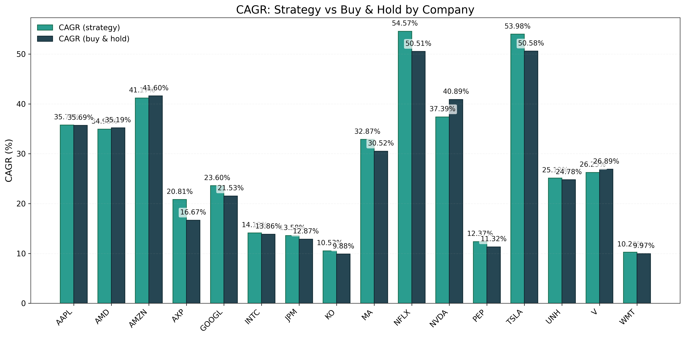
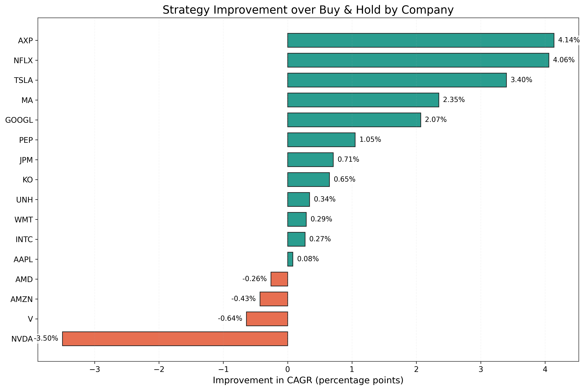
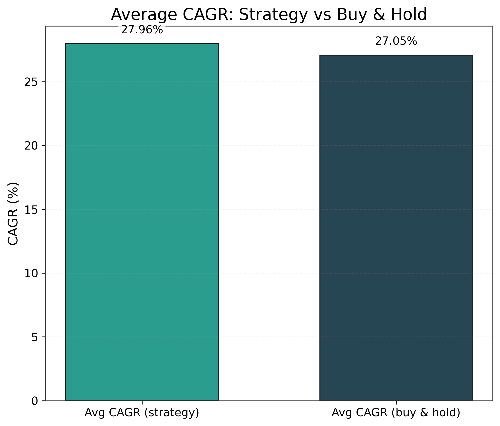
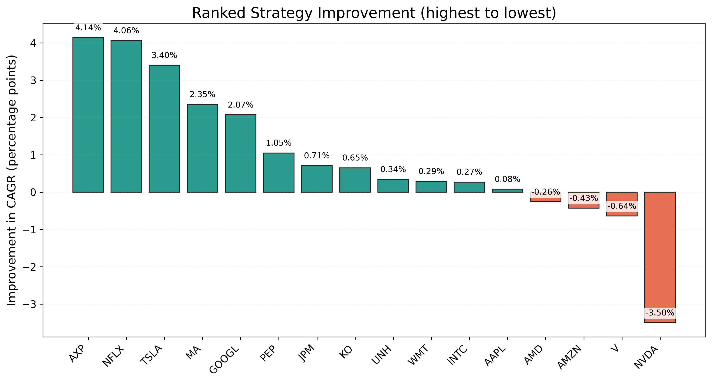

# AI-Powered Financial News Sentiment Trading Strategy

## Project Overview

This project explores the application of Natural Language Processing (NLP) to financial news sentiment for algorithmic trading. It involves building a robust system to analyze market sentiment from headlines using Hugging Face's FinBERT model and integrating it with technical indicators to generate actionable trading signals. The strategy was backtested on historical data for leading NASDAQ companies to evaluate its performance.

## Strategy Implemented

The core trading strategy is designed to capitalize on significant negative news sentiment combined with bearish technical signals:

* **Sentiment Signal:** Utilizes **Hugging Face's FinBERT model** to classify daily financial news headlines related to a company as positive or negative.
* **Technical Signal:** Checks if the **5-day Exponential Moving Average (EMA)** of the stock's closing price is lower than its **20-day EMA**, indicating a short-term bearish trend.
* **Trading Action:** If **negative news sentiment** is detected **AND** the **5-day EMA is below the 20-day EMA**, the strategy initiates a **short position** (or exits any long position) for a **3-day holding period**.

## Data Used

* **News Data:** Comprehensive historical news headlines and associated metadata for at least **10 years** for each of the selected companies.
* **Stock Data:** Historical daily stock prices (Open, High, Low, Close, Volume) for the corresponding companies, covering the period from 2009 to 2020.
* **Company Selection:** The strategy was tested on the **10 companies with the largest market capitalization** on the NASDAQ exchange around the start of the backtesting period (e.g., mid 2009).

## Backtesting & Results

The strategy was rigorously backtested using **Python** for a historical period spanning from **2009 to 2020**.

* **Scope:** Performance was evaluated across the portfolio of 10 selected NASDAQ large-cap companies.
* **Findings:** The backtesting results showed mixed performance. For some companies, the implemented strategy **outperformed a simple buy-and-hold strategy** over the 12-year period, while for others, it **underperformed**.
* **Key Insight:** This specific combination of FinBERT sentiment and EMA crossover proved to be the **best-performing strategy among numerous other strategies explored and tested** during the project's development. This highlights the potential of combining diverse signals, even if market efficiency makes consistent outperformance challenging.

## Technologies Used

* **Python:** Primary programming language.
* **Pandas:** For robust data manipulation, cleaning, and time-series analysis.
* **Hugging Face Transformers:** Specifically for implementing and leveraging the **FinBERT** pre-trained language model for financial sentiment analysis.
* **Yfinance (or similar data source):** For retrieving historical stock data.
* **Custom Backtesting Engine:** The backtesting simulation was built directly in Python (not relying on external backtesting frameworks like Backtrader), demonstrating a deep understanding of trade execution logic, position management, and performance calculation.

## Future Enhancements

* **Advanced NLP:** Explore more sophisticated NLP techniques, such as aspect-based sentiment analysis, entity linking, or transformer models fine-tuned on custom financial datasets.
* **Risk Management:** Implement more robust risk management techniques, including dynamic position sizing, stop-loss, and take-profit orders.
* **Transaction Costs:** Model realistic transaction costs (commissions, slippage) into the backtesting engine for a more accurate performance evaluation.
* **Machine Learning for Signal Fusion:** Use supervised or unsupervised learning models to combine sentiment and technical indicators for more nuanced signal generation.
* **Portfolio Management:** Extend the strategy from a single stock focus to a diversified portfolio.
* **Alternative Data:** Incorporate other alternative data sources (e.g., social media sentiment, satellite imagery, supply chain data).

---

## Key Results

The table below summarizes the core results computed from `returns.csv`.

| Metric | Value |
|---|---:|
| Number of companies evaluated | 16 |
| Average CAGR (strategy) | 27.96% |
| Average CAGR (buy & hold) | 27.05% |
| Average improvement (strategy − buy & hold) | 0.91 percentage points |
| Best performing company (strategy CAGR) | NFLX (54.57%) |
| Largest improvement over buy-and-hold | AXP (+4.14 percentage points) |
| Companies where strategy outperformed buy & hold | 12 of 16 |
| Worst relative performance (largest negative improvement) | NVDA (−3.50 percentage points) |

## Results

Below are the key visual results from the backtest and analysis. Each figure is saved in the `images/` folder at publication quality (PNG, dpi=300).

### CAGR Comparison



Figure: Comparison of CAGR achieved by the sentiment-based strategy versus a buy-and-hold baseline for each evaluated company. The grouped bar chart shows both series side-by-side to make per-company comparisons straightforward.

### Strategy Improvement



Figure: Improvement (strategy CAGR − buy & hold CAGR) for each company. Positive values indicate the sentiment-based strategy outperformed the buy-and-hold baseline; negative values indicate underperformance.

### Average CAGR



Figure: Average CAGR across all evaluated companies for the sentiment-based strategy versus buy-and-hold. This summarizes portfolio-level performance differences.

### Company Ranking



Figure: Companies ranked by their improvement over the buy-and-hold baseline (highest to lowest). This highlights which tickers gained the most from the strategy and which lagged behind.

---

Notes
- All figures are generated automatically by `generate_figures.py` and saved to the `images/` folder.
- The repository avoids changing any calculation or strategy logic; visualizations and documentation are presentation-only enhancements for portfolio quality.

Reproduce the figures locally:

```bash
python generate_figures.py
```

