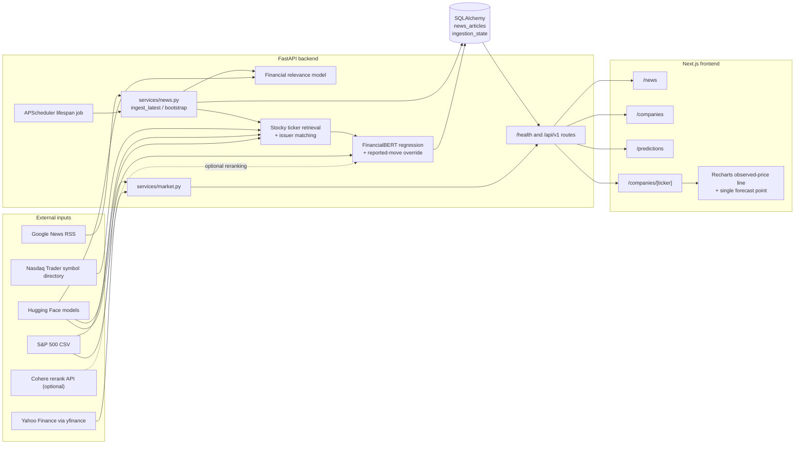

# FinSight — Project Audit and Technical Handover

**Audit scope:** repository contents currently present in the worktree. This document describes code evidence, not a runtime deployment or independent validation of external model quality. Paths below are repository-relative.

## Executive summary

FinSight currently contains two related but distinct bodies of work:

1. **A runnable news-inference POC**: a FastAPI backend collects Google News RSS stories, applies a pretrained financial-relevance model, retrieves S&P 500 ticker candidates with Stocky, enriches issuer evidence, optionally estimates impact with a FinancialBERT regression head, and persists stories in SQLite or PostgreSQL. Its active frontend displays the stored news, S&P 500 quotes, and a company-specific point forecast.
2. **An older research notebook and report artifacts**: `main.ipynb`, the data-preparation scripts, `returns.csv`, and the PNGs describe an experimental FinBERT/technical-rule strategy. This is not the active API’s backtesting path. The notebook depends on absent `data/` inputs, computes rolling averages shifted into the future, and the repository contains no backtest API or active backtest page.

The backend has real ingestion, database persistence, relevance scoring, Stocky candidate retrieval, issuer-name matching, impact inference, and daily-price retrieval. Tests exercise important parts of these paths, mostly with external services and models patched; they do **not** establish external model quality or a profitable strategy. Article-level FinBERT sentiment fields remain nullable and are not computed by ingestion. Event type, event severity, novelty, information surprise, market regime, calibrated confidence, abstention decisions, and an end-to-end backtest are not implemented in the active system.

The current frontend is not a full multi-page research dashboard: `/news`, `/companies`, `/companies/[ticker]`, and `/predictions` are the meaningful pages. The dashboard, events, backtesting, saved, and watchlist URLs redirect to `/news`. The only frontend chart is a Recharts line chart on a company page: it combines fetched historical adjusted closes with one 30-day forecast point, not a forecast path or interval.

### Current architecture

## Actual end-to-end data flow

### 1. Source and ingestion trigger

- The configured source is Google News RSS (`google_news_rss_url`, default in `backend/app/core/config.py`). `backend/app/services/news.py::_default_rss_url`, `_google_news_url`, and `_feed_queries` choose the feed URL or dated search windows. A configured legacy `when:1d`, `when:7d`, or `when:30d` query is deliberately replaced by the broad feed.
- `backend/app/main.py::lifespan` starts an APScheduler background job when `NEWS_INGEST_ENABLED` is true. Its first execution is scheduled 30 seconds after startup and it repeats at `NEWS_POLL_MINUTES` intervals. `_scheduled_ingest` opens a SQLAlchemy session, may bootstrap an archive, refreshes a bounded relevance batch, backfills missing impacts, then calls `ingest_latest`.
- `POST /api/v1/news/ingest` also calls `ingest_latest`, with a bounded `limit` and optional ticker-specific RSS query. A process-local lock in `backend/app/services/news.py` prevents overlapping manual/scheduled ingest calls inside one process; it is not a distributed lock across multiple backend workers.

### 2. Parsing, normalization, deduplication, persistence

- `_ingest_latest` in `backend/app/services/news.py` fetches RSS with `httpx`, parses it with `feedparser`, and takes at most 100 entries per feed window. It reads the entry’s `title`, `link`, `summary`, publisher and parsed publication time (`_published_at`).
- It rejects entries missing a title or link and repeated exact URLs in the same run; it also queries `news_articles.url` before creating a row. The database has a unique URL constraint. There is no broader canonical URL normalization, story-cluster deduplication, or repeated-event matching.
- Normal ingestion runs `analyze_headline(title, summary)` before storing the row, then runs `add_impact_predictions` for its ticker candidates. It stores the RSS summary as received, but the analysis and issuer-matching logic use the headline as the reliable source text. Archive-only bootstrap writes pending-enrichment placeholders and defers Stocky and impact inference to `backfill_missing_impacts`.
- `IngestionState` stores attempts, successes, error text, last result, archive day and usefulness-backfill position. Ingestion commits the articles and success status together; on failure it rolls back and commits the error status separately.
- `NewsArticle` in `backend/app/db/models.py` is the persistent record. JSON fields hold candidates, per-ticker impacts and usefulness. There are no separate companies, tickers, raw feed entries, price bars, prediction runs, event records, sentiment records or backtest-result tables.

### 3. Financial relevance and company/ticker identification

- `analyze_headline` calls `_classify_usefulness`, which delegates to `backend/app/ml/financial_relevance.py::score_financial_relevance`. This uses a lazily loaded Hugging Face sequence-classification model (`FINANCIAL_RELEVANCE_MODEL_ID`, default `stocky-ai/fin-impact-xlmr`) and a configured threshold. This is an ML relevance estimate, not sentiment.
- If the story is not labelled useful, `analyze_headline` returns no ticker candidates and skips Stocky retrieval. An unavailable model is labelled `unavailable`; that is not considered `useful`, so Stocky inference is skipped for that article.
- For a useful story, the code loads the S&P 500 constituent CSV and Nasdaq Trader symbol directory. `_explicitly_named_companies` builds a normalized issuer alias index and matches full names/aliases and selected uppercase ticker tokens. Explicitly named companies are restricted to S&P 500 members before inclusion.
- `backend/app/ml/stocky.py::retrieve_tickers` loads the upstream Stocky implementation and weights from the local artifact directory or downloads them from the configured Hugging Face repository. It embeds the headline and S&P 500 ticker strings, takes a contrastive top-k shortlist, scores headline/ticker pairs with the reranker, and returns scores. Exact-name matches are merged with Stocky candidates, with evidence fields and sector/security metadata added.
- This is candidate retrieval and rule-based name/ticker evidence, not a general entity extraction system or a guaranteed correct ticker attribution. S&P 500 scope limits the main analysis, even though the broad listed-symbol directory is used to resolve issuer names.

### 4. Article sentiment, impact, and usefulness

- **Article sentiment:** The standalone classifier in `backend/app/ml/finbert.py` loads `ProsusAI/finbert` and exposes `classify_sentiments`/`classify_sentiment` with positive, neutral and negative scores. Current ingestion does not call it. New article rows explicitly store `sentiment`, `sentiment_score` and `sentiment_scores` as `None`; the later migration makes those columns nullable. The `/news?sentiment=...` filter therefore only filters rows that have sentiment populated by some other means.
- **Usefulness/relevance:** `_classify_usefulness` is a wrapper around the pretrained relevance regression model. The score is clamped to 0–10 and compared with `FINANCIAL_RELEVANCE_THRESHOLD`; `FINANCIAL_RELEVANCE_MAX_SCORE` can rescale outputs. The model’s actual calibration and intended raw score scale are not established by repository tests. This label is not a learned “article usefulness” target trained in this project.
- **Per-ticker impact:** `add_impact_predictions` selects up to `IMPACT_CONTEXT_LIMIT` prior, earlier-published articles associated with each ticker and conditions `classify_impact` on company name, sector, security type, prior headlines and current headline. `backend/app/ml/financialbert.py` loads the local `model_regressor_weight_v2.pth`, uses a pretrained FinBERT encoder, and applies a one-output linear head. `classify_impact` buckets the output using `IMPACT_NEUTRAL_BAND`; the raw regression output is retained. If the checkpoint is absent, the impact result is unavailable.
- `_reconcile_reported_moves` can replace a model impact with a simple positive/negative reported-share-move rule when the issuer is explicitly named and the security is common stock/ADR. This is an evidence override, not an estimate of future reaction.
- **Per-company forecast:** `GET /api/v1/companies/{ticker}/prediction` independently selects candidate-linked stored articles, ranks explicit issuer mentions/relevance/date and optionally calls Cohere reranking if `COHERE_API_KEY` is configured. It concatenates the selected RSS descriptions (falling back to titles) and calls `predict_expected_return`. The returned value is presented as an expected 30-day return and multiplied by the latest adjusted close to create one forecast price. There is no confidence interval, calibration layer, probability of direction, abstention rule, or validation against the future realized outcome in this request path.

### 5. Market data, API, and frontend

- `backend/app/services/market.py` loads S&P 500 company/sector names through `get_sp500_universe`. It obtains adjusted daily prices from `yfinance`. The companies listing endpoint refreshes page quotes asynchronously into a process-local cache; the company detail/forecast path requests daily history directly. Quote history is not persisted in the database.
- `backend/app/api/v1/news.py` exposes the API. News listing uses descending publication/ingestion order, filters and cursor pagination, and returns persisted article fields through `NewsOut`. It hydrates legacy candidate issuer evidence without invoking the expensive relevance model on every page. It may classify rows missing usefulness metadata and commit those changes.
- The active Next.js pages use `NEXT_PUBLIC_API_BASE_URL` (default `http://localhost:8000/api/v1`): `/news` pages through `/news` with `X-Next-Cursor`/`X-Has-More`; `/companies` fetches `/companies`; `/predictions` fetches `/universe/sp500`; and `/companies/[ticker]` fetches `/companies/{ticker}/prediction`. The forecast page renders returned daily closes and the one prediction point using `PricePredictionChart`.
- The frontend does not call `/analyze`, `/news/ingest`, `/news/ingestion-status`, `/news/{id}`, or the legacy `/universe/us-listed`. Other apparent research pages redirect rather than displaying backend data.

## Implemented versus planned features

Status meanings here are evidence-based: *working* means there is a live code path and relevant tests or direct integration evidence in the repository; it does not mean predictive quality is independently proven.

| Capability | Status | Evidence and boundary |
|---|---|---|
| Financial sentiment / tone classification | **Implemented but not fully integrated** | `backend/app/ml/finbert.py` provides pretrained FinBERT classification, but ingestion does not call it and stores nullable tone fields. |
| Financial relevance scoring | **Implemented and working** | `score_financial_relevance` is called by `analyze_headline` and ingestion; tests patch it to verify screening behavior. Actual model calibration is unverified. |
| Article usefulness scoring | **Partially implemented** | Relevance score is labelled useful/not useful and stored, but no independent usefulness model, human labels, evaluation or calibrated quality measure exists. |
| Company/entity identification | **Partially implemented** | Stocky ticker ranking plus alias/ticker rules are wired; coverage is constrained to S&P 500 and name/ticker ambiguity remains possible. |
| Event impact or severity classification | **Partially implemented** | FinancialBERT’s regression output is bucketed per candidate; a rule can override with a reported direction. It is not an independently validated event-impact/severity classifier and a missing checkpoint produces no forecast. |
| Duplicate/repeated-event detection | **Partially implemented** | Exact URL deduplication and a unique URL constraint exist. Canonical URL, syndicated-copy, semantic duplicate and repeated-event detection do not. |
| Novelty / information-surprise calculations | **Not found** | “Novelty” in demo data is hand-authored placeholder content; no active model, stored field or calculation was found. |
| Market regime analysis | **Not found** | Demo regime values are static; there is no active regime detector or persisted regime series. |
| Stock reaction prediction | **Implemented but not fully integrated** | An upstream-trained regression head is invoked for article impact and company forecasts. The output is a point estimate; predictive validity, timing and causal interpretation are unestablished. |
| Prediction confidence and abstention | **Not found** | No confidence/uncertainty output or thresholded TRADE/WATCH/ABSTAIN decision exists in the active backend. Demo decision types/cards are not wired to it. |
| Backtesting without look-ahead bias | **Planned or documented only** | `main.ipynb` and `returns.csv` document an older experiment, not the running app. The notebook’s shifted rolling averages introduce future information; a valid out-of-time, look-ahead-safe backtest is not established. |

## Backend and database status

### Backend structure and dependencies

The FastAPI application is a small modular monolith: `backend/app/main.py`, `api/`, `services/`, `ml/`, `db/`, and `core/`. `backend/app/api/v1/router.py` currently includes only the news router, despite that router also containing company and universe routes. `backend/app/models/`, `repositories/`, `schemas/`, `backtesting/`, and training/inference/metadata directories are placeholders, not implementations.

Backend package dependencies are declared in `backend/pyproject.toml`: FastAPI, SQLAlchemy 2, Alembic, Pydantic Settings, feedparser, httpx (dev extra), pandas, yfinance, APScheduler, PyTorch, Transformers, Hugging Face Hub, psycopg and Uvicorn. `cohere` is imported optionally at runtime when an API key is set but is not a declared project dependency; failure is caught and falls back to local ranking. Root `requirements.txt` is a legacy/minimal list (`pandas`, `yfinance`, `lxml`, `requests`) and is not sufficient to install the active backend. Follow the README’s backend editable-install instructions instead.

### Database, models, and migrations

- **Technology:** SQLAlchemy 2 supports SQLite and PostgreSQL. With `DATABASE_URL` set, that URL is used; relative SQLite paths are resolved from `backend/`. Without it, no `POSTGRES_PASSWORD` means a local `backend/finsight.db`; with a password, a PostgreSQL URL is assembled from the `POSTGRES_*` settings. SQLite enables a 30-second timeout, `busy_timeout`, and WAL. PostgreSQL JSON uses JSONB through a type variant.
- **`news_articles`:** `NewsArticle` fields are `id`, `title`, `summary`, `url`, `source`, `published_at`, `ingested_at`, nullable `sentiment`, `sentiment_score`, `sentiment_scores`, JSON `ticker_candidates`, JSON `impact_predictions`, and JSON `usefulness`. `url` is unique; publication time is indexed. There are no ORM relationships or foreign keys.
- **`ingestion_state`:** `IngestionState` stores one intended row (id 1) with poll attempt/success timestamps, archive cursor day, error and last-result JSON, and relevance backfill cursor. The model’s integer primary key does not itself constrain the table to a singleton row.
- **Migration chain:** `20261009_01_news_articles` creates the base news table and non-null legacy sentiment columns; `20261009_02_impact_tone` adds JSON impacts; `20261009_03_article_usefulness` adds usefulness; `20261009_04_stop_article_tone` makes the sentiment columns nullable; `20261009_05_ingestion_state` creates ingestion state. `alembic/env.py` imports model metadata but the migration environment runs the explicit revisions; there is no startup `create_all`.
- **Schema caveats:** the initial migration declares `source` non-null with no server default, while the ORM supplies a Python default; application-created records supply a source. Model-side defaults such as `ingested_at`, `impact_predictions`, and `IngestionState.id` are not all server-side defaults. A migration-created database is therefore the supported initialization path, not implicit app-startup table creation. `backend/alembic/versions/__init__.py` and `.gitkeep` are not meaningful revisions.
- **Local initialization:** run Alembic from `backend` with the same `DATABASE_URL` that the API will use (`alembic upgrade head`). The README example uses SQLite and disables scheduled ingestion for a predictable initial server run. PostgreSQL is optional and provided only as a Compose database service; no application Dockerfile or complete application Compose service is present.

### API routes

All routes below are mounted under `/api/v1` except `/health`. Explicit Pydantic request/response schemas exist only for analyze/ingest requests and news rows; several company/universe/status endpoints return untyped dictionaries, so their exact schema is implementation-derived rather than enforced by a response model.

| Method and route | Request | Response and purpose | Evidence/tests |
|---|---|---|---|
| `GET /health` | None | `HealthResponse` `{status: "ok"}`; process health only, does not check database, models or external providers. | Tested by `backend/tests/test_health.py`. |
| `GET /api/v1/news` | Query: `limit` 1–200 (default 50), opaque `cursor`, `before`, `sentiment` enum, `ticker`, `useful_only`. | `list[NewsOut]`; newest-first persisted stories, optional filtering and cursor headers `X-Has-More`, `X-Next-Cursor`. Adds short private cache headers. | Contract tests cover output, useful filter, cursor headers/CORS. |
| `GET /api/v1/news/{article_id:int}` | Integer path ID. | `NewsOut`; stored story with hydrated candidate evidence; 404 if absent. | Route not directly tested in the observed suite. |
| `GET /api/v1/news/{article_id}/open` | Integer path ID. | 307 redirect to source; attempts to resolve Google News redirects first. Hidden from OpenAPI. | Not directly tested. |
| `GET /api/v1/news/ingestion-status` | None. | Untyped status object: enabled/poll interval, latest attempt/success, archive day, error/result, cached relevance-model status. | Not directly tested. |
| `POST /api/v1/news/ingest` | `IngestRequest`: `limit` 1–100 (default 25); optional ticker 1–16 characters matching the declared alphanumeric/dot/hyphen pattern. | Untyped ingestion result (`fetched`, `created`, `skipped`, archive fields); errors become 502. | Ingestion behavior and serialization tested via direct service tests, not route request. |
| `POST /api/v1/analyze` | `AnalyzeRequest`: headline 4–2000 chars, optional summary up to 12000 chars. | Untyped usefulness and ticker-candidate analysis object, plus empty `impact_predictions`; errors become 503. This route does not persist the article or add impact predictions. | Analysis behavior tested through service-level tests; not the route itself. |
| `GET /api/v1/universe/sp500` | None. | `{count, constituents}` from cached remote S&P CSV. | Used by the predictions page; failure becomes 502. |
| `GET /api/v1/universe/us-listed` | `refresh` boolean (default false). | `{count, source, source_url, filters, retrieved_at, securities}` from Nasdaq Trader, cached per process. | No dedicated endpoint test observed. |
| `GET /api/v1/companies` | `limit` 1–500 (default 100), `offset` (default 0). | `{total, offset, count, source, retrieved_at, companies[]}`; S&P rows with asynchronously refreshed Yahoo daily quote fields. | Company page uses it; external errors become 502. |
| `GET /api/v1/companies/{ticker}` | Ticker path. | One company row with latest daily quote and retrieval/source metadata; 404 for non-S&P ticker, 502 for provider failures. | Not directly tested. |
| `GET /api/v1/companies/{ticker}/prediction` | Ticker path. | Untyped response containing history, latest/previous close, daily change, optional `prediction` (`expected_return`, `forecast_price`, `as_of`, `horizon_days`), `news_used`, status/model metadata. Not-found ticker is 404; missing history/news/checkpoint is represented by status and null prediction; other failures become 502. | Contract test patches market data and model, verifying assembly, not live model quality. |

`backend/app/main.py` permits GET/POST/OPTIONS and all headers for the configured CORS origins. Its exposed cursor headers support the cross-origin news feed.

### Environment and local development

`backend/app/core/config.py` defines these backend environment variables (with defaults there and sample values in `backend/.env.example`):

- Application: `APP_NAME`, `ENVIRONMENT`, `CORS_ORIGINS`.
- Database: `DATABASE_URL`; fallback pieces `DATABASE_HOST`, `POSTGRES_DB`, `POSTGRES_USER`, `POSTGRES_PASSWORD`, `POSTGRES_PORT`.
- Sources: `SP500_CONSTITUENTS_URL`, `US_LISTED_SYMBOLS_URL`, `GOOGLE_NEWS_RSS_URL`.
- Ingestion: `NEWS_POLL_MINUTES`, `NEWS_INGEST_LIMIT`, `NEWS_ARCHIVE_BOOTSTRAP_DAYS`, `NEWS_ARCHIVE_BOOTSTRAP_ARTICLES`, `NEWS_INGEST_ENABLED`.
- Models/ranking: `FINBERT_MODEL_ID`, `FINANCIAL_RELEVANCE_MODEL_ID`, `FINANCIAL_RELEVANCE_THRESHOLD`, `FINANCIAL_RELEVANCE_MAX_SCORE`, `FINANCIAL_RELEVANCE_ENABLED`, `FINANCIALBERT_WEIGHTS_PATH`, `IMPACT_CONTEXT_LIMIT`, `FINANCIALBERT_NEWS_TOP_K`, `IMPACT_NEUTRAL_BAND`, `STOCKY_MODEL_ID`, optional `COHERE_API_KEY`, and `COHERE_RERANK_MODEL`.

For the frontend, `NEXT_PUBLIC_API_BASE_URL` selects the API base; otherwise it defaults to localhost. The documented workflow requires Python 3.11+, Node 20.9+, installing `backend[dev]`, running the Alembic migration, starting Uvicorn from `backend`, then running `npm ci` and `npm run dev` from `frontend`. Hugging Face downloads and external Google News/Nasdaq/S&P/Yahoo access require internet. The FinancialBERT checkpoint path must exist; Stocky can download large upstream artifacts on first use. No secret values are included here.

## Frontend page-by-page status

The visual shell is dark-themed Tailwind CSS (`frontend/app/globals.css`), with navigation in `frontend/components/shell.tsx`, shared layout primitives in `frontend/components/ui.tsx`, and demo-only cards in `frontend/components/cards.tsx`. There are no active charts outside the company detail chart.

| Route | Purpose/components | Charts | Data source | End-to-end status and limitations |
|---|---|---|---|---|
| `/` | `frontend/app/page.tsx` | None | Redirect | Functional redirect to `/news`; no homepage dashboard. |
| `/news` | `frontend/app/(workspace)/news/page.tsx`; `PageHeader`, `Panel`, `SearchInput`, `StatusBadge`, expandable article details and ticker links. | None | Real `/news` API rows; client-side text filtering. | Functional for reading stored news, loading older rows and opening source URLs. Polls newest page every 60 seconds. No controls for backend filters, ingestion status or manual ingest. No sentiment chart; this feed shows per-ticker candidate/impact metadata. |
| `/companies` | `frontend/app/(workspace)/companies/page.tsx`; table, search, pagination, status and empty/error states. | None | Real `/companies` API; quote values from Yahoo Finance via yfinance. | Functional for S&P 500 directory and latest available daily quotes. Quote polling retries pending batches for up to 20 × 3 seconds. Quotes are not real-time and may be unavailable; this page does not graph market data. |
| `/companies/[ticker]` | `frontend/app/(workspace)/companies/[ticker]/page.tsx`; stat cards, `PricePredictionChart`, selected-news panel. | One Recharts `LineChart`: actual adjusted daily close line plus isolated/dashed forecast point. | Real `/companies/{ticker}/prediction` response, including real yfinance history and model output if available. | Functional when API, price provider, stored linked news, model encoder/checkpoint work. It draws no continuous forecast trajectory, interval or uncertainty band; selected news and point-estimate claims remain experimental. |
| `/predictions` | `frontend/app/(workspace)/predictions/page.tsx`; S&P 500 selector/search, navigate button. | None | Real cached `/universe/sp500` API response. | Functional as a company chooser that links to the detail forecast; does not itself calculate or display a forecast. |
| `/dashboard` | `frontend/app/(workspace)/dashboard/page.tsx` | None | Redirect | Redirects to `/news`; no dashboard KPIs or backend aggregates. |
| `/events` | `frontend/app/(workspace)/events/page.tsx` | None | Redirect | Redirects to `/news`; there is no event classification/detail feed. |
| `/events/[id]` | `frontend/app/(workspace)/events/[id]/page.tsx` | None | Redirect | Redirects to `/news`; no event detail route despite demo-card links. |
| `/backtesting` | `frontend/app/(workspace)/backtesting/page.tsx` | None | Redirect | Redirects to `/news`; no API-backed backtest UI. |
| `/saved` | `frontend/app/(workspace)/saved/page.tsx` | None | Redirect | Redirects to `/news`; no saved-analysis state/storage. |
| `/watchlist` | `frontend/app/(workspace)/watchlist/page.tsx` | None | Redirect | Redirects to `/news`; no user watchlist. |

Only News, Predictions and Companies appear in the navigation. `frontend/lib/demo-data.ts` contains illustrative news/company/trend/market/equity/drawdown/regime arrays. The reusable demo cards label analysis as unavailable/demo; those arrays are not rendered by the current route pages. `frontend/components/charts.tsx` imports **Recharts**; the offline research plotting script uses **Matplotlib** and creates PNGs, not browser charts.

### Existing visualization inventory

| Visualization | Location | Data provenance |
|---|---|---|
| Observed adjusted close + single 30-day forecast point (line chart) | `frontend/components/charts.tsx::PricePredictionChart`, rendered on company detail | Observed prices come from yfinance; point derives from FinancialBERT output and latest observed close. It is the only active frontend chart. |
| Company-vs-buy-and-hold CAGR grouped bars | `images/cagr_comparison.png`; generated by `generate_figures.py` | Static `returns.csv`; inherited/offline experiment, not API output. |
| Strategy improvement by company (horizontal bars) | `images/strategy_improvement.png` | Static `returns.csv`; offline, not current app output. |
| Average strategy-vs-buy-and-hold CAGR bars | `images/average_cagr.png` | Static `returns.csv`; offline, not current app output. |
| Strategy-improvement histogram | `images/improvement_histogram.png` | Static `returns.csv`; offline, not current app output. |
| Ranked improvement bars | `images/improvement_rank.png` | Static `returns.csv`; offline, not current app output. |

All offline plots are generated from aggregate CAGR columns; none supplies a daily equity curve or verifies the strategy with a walk-forward methodology. Demo chart data arrays do not count as currently displayed charts.

## Model and algorithm inventory

| Model/algorithm | Purpose | Input features | Output | Implementation file | Provenance | Connected to running app? | Current limitations |
|---|---|---|---|---|---|---|---|
| ProsusAI FinBERT classifier | Financial text polarity/tone | Headline/text strings, tokenized/truncated by Transformers pipeline | Positive/neutral/negative labels and confidence scores | `backend/app/ml/finbert.py` | Pretrained/external | **No, not in current ingestion or UI API flow** | Functionality exists, but article tone columns are written as null; no active tests establishing model outputs/calibration. |
| `stocky-ai/fin-impact-xlmr` relevance regression | Screen articles for market relevance/usefulness | Headline tokens, max length 256 | Scalar regression output, clamped/scaled to 0–10 and threshold label | `backend/app/ml/financial_relevance.py`; used in `backend/app/services/news.py::_classify_usefulness` | Pretrained/external | **Yes** | Raw model scale/calibration not tested against real labels; no training/evaluation data in repo. Score called usefulness is essentially relevance. |
| Stocky contrastive title/stock retrieval | Rank possible S&P 500 issuers for a headline | Headline embedding and ticker-symbol text embeddings over S&P 500; top-k pairs passed to reranker | Candidate ticker and sigmoid relevance score | `backend/app/ml/stocky.py`; upstream code/artifacts in `backend/app/ml/artifacts/stocky/` | Pretrained/external | **Yes**, lazy load/download | Heavy artifacts and runtime dependencies; S&P-only scope; ticker similarity is not definitive entity resolution. |
| Explicit company/ticker matching | Recover named issuers and attach evidence | Headline text, aliases derived from Nasdaq security names, uppercase ticker token and local finance-context patterns | `entity_mentioned`, candidate source/evidence fields | `backend/app/services/news.py::_name_aliases`, `_explicitly_named_companies`, `_company_is_mentioned` | Rule-based | **Yes** | Alias and contextual heuristics can miss aliases or produce false matches; short tickers deliberately excluded from direct matching. |
| FinancialBERT Model v2 regression | Estimate issuer-conditioned return/impact | FinancialBERT `[CLS]` embedding of concatenated company/sector/security, prior headlines and current headline; max 512 tokens | One raw scalar; impact helper buckets around a neutral band | `backend/app/ml/financialbert.py`; called by `add_impact_predictions` | Pretrained encoder + externally sourced released regression-head checkpoint; not trained by this project | **Yes**, when the local checkpoint and encoder can load | Checkpoint is a required runtime file; output has no uncertainty/calibration. Repository carries no robust out-of-time performance evidence. |
| Reported-move reconciliation | Prefer direction explicitly reported in an issuer headline over an inconsistent model label | Headline sentences, issuer aliases and lists of positive/negative move words | `reported_market_move` impact direction; regression return cleared | `backend/app/services/news.py::_reported_direction`, `_reconcile_reported_moves` | Rule-based | **Yes** | Detects wording in the news text, not a prospective reaction; relies on nearby issuer/move tokens and only applies to common stock/ADR with explicit mention. |
| Cohere reranker | Optionally select company-relevant retrieved descriptions | Company-specific query and document descriptions | Ordered top-N document list | `backend/app/services/news.py::rerank_company_news` | External hosted model/service | **Optional**; only when `COHERE_API_KEY` is present | Not a declared dependency; errors silently switch to the local deterministic ordering after logging. External key/network needed. |
| Local news fallback ranking | Prefer explicitly named issuer, relevance score and recency | Candidate metadata and publication date | Sorted top-k descriptions | `backend/app/services/news.py::rerank_company_news` | Rule-based | **Yes** when Cohere absent/fails | Ranking heuristic, not a learned ranker; date is a ranking preference. |
| Legacy technical/sentiment strategy | Experimental historical trading rule | Notebook sentiment aggregated by date; daily OHLC, 5-/20-span EWM-like averages | CAGR comparison | `main.ipynb` cells for sentiment, `config`, `calculate`, `CAGR`; output `returns.csv` | Pretrained sentiment + hand-written trading rules; not trained by current project | **No**, separate notebook, missing its referenced `data/` folder | `shift(-1)` moves moving-average information from the next row into the current row; this is look-ahead leakage. Notebook’s yfinance window and headline dataset coverage also limit reproducibility. |

## Risks, readiness, and known unknowns

### Confirmed from repository evidence

- **No active sentiment field population:** the news ingestion constructor explicitly assigns all three sentiment columns `None`; the FinBERT classifier is not imported by that pipeline.
- **The named dashboard pages are mostly route shells:** the listed routes redirect to the live news feed, and demo arrays/cards are not an implemented analysis backend.
- **Research notebook inputs are absent:** `prepare_data.py` and `prepare_dataset.py` write/read `data/*.csv`, but the repository file inventory contains no `data/` directory or raw datasets. The notebook cannot reproduce `returns.csv` from the checked-in inputs alone.
- **Known backtest look-ahead:** `main.ipynb::config` computes exponentially weighted means and applies `shift(-1)`, then `calculate` consumes those values for trade decisions. That puts next-row information into the current row.
- **Limited tests:** two backend test files contain 17 test methods (one health test and 16 news/API-contract tests). Several tests are valuable integration contracts, but model/provider/database paths are commonly mocked or SQLite in-memory. No frontend test suite, CI workflow, model evaluation suite, migration test suite, end-to-end browser tests, or backtest validation suite was found.
- **No application container build:** `docker-compose.yml` starts PostgreSQL only. It does not build or run backend/frontend containers.
- **External data is not versioned:** S&P constituents, Nasdaq listings, Google RSS and yfinance are live/unofficial inputs. The S&P and symbol directories are process-cached; cache invalidation is generally restart-based except the explicit symbol refresh endpoint.
- **Impact outputs and forecasts are different semantics:** per-article impact consumes a model regression and then thresholds it; a report of an already observed move can replace that output. Company forecasts use a separate route that retrieves descriptions, predicts a scalar, and maps it to a price point. Neither output is an independently verified trading signal.

### Potential risks requiring runtime confirmation

- **Concurrent workers:** ingestion serialization is a Python process lock. Multiple Uvicorn workers or replicas can race on inserts/archive state; the unique URL constraint can reject a duplicate transaction. No database-level job lease is implemented.
- **Scheduled job resource use:** bootstrap and bounded legacy backfills can load/download models and make many sequential inference calls on the scheduler thread. Heavy Transformers/PyTorch models can impose substantial RAM/CPU/GPU and cold-start costs. Exact production memory/latency is unknown.
- **Quote-cache freshness and opaque failures:** `_refresh_quotes` catches all exceptions without logging them and the process cache has no TTL. A failed refresh can yield unavailable values, while previously cached values can persist indefinitely. This is confirmed code behavior; actual user impact depends on provider/runtime behavior.
- **Partial provider degradation:** archive bootstrap may create `archive_only_pending_enrichment` rows, and the company forecast depends on network access, matching stored news, model files and price history. These have explicit status/null paths, but there is no unified readiness endpoint.
- **Search/read cost:** company prediction scans the time-ordered stored article set and loops through candidates in Python; news filtering similarly scans batches to fill result pages. This can become expensive as the archive grows. No query plan/load test is present.
- **Cohere configuration:** setting `COHERE_API_KEY` without installing the optional `cohere` package causes reranking to fail and fall back. The exception is logged, but a caller sees no explicit “fallback used” field in the forecast response.
- **No authentication/authorization:** the API defines no user auth. If exposed beyond a trusted local environment, users could trigger manual ingestion and heavyweight analysis. Whether network access is restricted by deployment infrastructure is unknown.
- **External URL redirect:** `/news/{id}/open` redirects to the stored article URL and follows Google News redirects. Current rows originate in RSS, but there is no explicit destination allowlist. Treat any future alternate article-ingestion source as a trust boundary.
- **Input/config hardening:** Pydantic constrains headline/summary and ingest limit/ticker, but free ticker path parameters and list-news `ticker` do not have equivalent ticker validation. No rate limiting or request-size/security headers are evident in this repository.
- **Frontend error and polling states:** the active pages provide useful loading/error/empty states. News polls the newest page every minute; companies can poll quote readiness for up to a minute. Network cancellation, retry/backoff strategy, and stale-data age labeling are limited.
- **Financial reproducibility and leakage:** archived RSS availability, publication timestamp parsing, yfinance adjustments, ticker membership snapshots, and downloaded model revisions are not pinned as a reproducible data/model release. No walk-forward or point-in-time constituent evaluation is present.

### Security, input validation, and data quality

No credentials are embedded in the code examined; `backend/.env.example` uses a replace-me password placeholder. Settings load `.env` and ignore unknown keys. CORS defaults to local origins, but CORS is not authentication. Logs avoid most full article content except selected headline logging, but store and return article headlines/summaries publicly through the API. Deployment access policy and data-retention obligations are unknown.

The RSS URL uniqueness constraint is useful but only catches exact URL repeats. Publication timestamps that fail parsing become null, summaries are stored as RSS HTML/boilerplate, and no source verification, canonical publisher URL extraction guarantee, language detection, data-quality score, or point-in-time model/universe snapshot is persisted. Impact context is restricted to earlier `published_at` stories, which is directionally safer than using later rows, but it does not prove the upstream regressor’s training/evaluation was leakage-free.

## Frontend visualization opportunities

The backend currently provides headline, publication/ingestion timestamps, source, optional sentiment fields, usefulness metadata, candidate tickers/names/sector/relevance/entity evidence, per-ticker impact status/class/raw regression, model name, context count/article IDs, and company daily adjusted closes plus one point forecast. It does **not** provide event classes/severity, novelty, surprise, regime labels, market benchmarks, calibrated uncertainty, realized event-window returns, or backtest time series. The proposals distinguish directly buildable views from requests that need new API/ML/research work.

| Rank / idea | Question answered | Exact required data fields | Fields currently in backend? | Work needed | Suitable chart |
|---|---|---|---|---|---|
| 1. News + observed price reaction timeline | What price moves occurred around the selected issuer’s news, and how did model estimates compare? | Event `published_at`, ticker, headline, sentiment/relevance/impact, daily prices, market-close calendar, event-window returns (e.g. −1/+1, +1/+5 days), adjusted-vs-market return. | Partial: article times/tickers/impact and company daily closes exist; article sentiment is usually null; no aligned event returns/benchmark series. | **API/data work** to align news and prices and compute clearly labelled observed forward outcomes; front-end chart can then build. | Synchronized price line with event markers and sentiment/impact color; optionally a lower return strip. |
| 2. Forecast uncertainty and abstention panel | When should a user trust or ignore a model estimate? | Forecast return/price, model ID/revision, data sufficiency, uncertainty interval or quantiles, calibration bucket, abstain reason, selected article count/age. | Partial: scalar estimate, model name, forecast date/horizon and news list/count are returned. No uncertainty, calibration or abstention fields. | **New ML/evaluation and API work** before presenting uncertainty; do not invent confidence from the regression scalar. | Fan chart or prediction interval over observed line, with explicit abstention state. |
| 3. Backtest equity curve and drawdown | Did a defined strategy compound capital, and what losses/underwater periods did it experience? | Timestamped equity, benchmark equity, position/transactions, costs/slippage, peak equity, drawdown, cash/exposure, strategy config and evaluation split. | No time-series backtest outputs. `returns.csv` only has aggregate CAGR fields. | **New backtest and API work** with leakage controls and reproducible cost assumptions. | Dual equity curves plus synchronized drawdown area. |
| 4. Actual vs predicted abnormal-return calibration | Are predictions directionally/calibrationally useful after market movement is removed? | Prediction timestamp/horizon, forecast return, realized ticker return, benchmark/sector return, abnormal return, coverage and error metrics. | Only forecast point and price history; no stored prediction records or realized event outcomes/benchmark returns. | **New persisted prediction/evaluation pipeline and API work.** | Predicted-vs-realized scatter with calibration line and residual distribution. |
| 5. Novelty and event-impact landscape (including radar) | Which stories are unusual and which dimensions make them potentially material? | Novelty/surprise score, impact score, event category, financial relevance, sentiment polarity/magnitude, issuer specificity, uncertainty, provenance. | Relevance score and model impact scalar/class are partial inputs. No novelty, event category/severity, surprise or confidence. | **New NLP/event-history scoring and API work**; radar is possible only when dimensions have valid, documented scales. | Radar/spider for a selected event with score definitions; companion ranked dot plot to compare events. |
| 6. Market-regime × sector performance matrix | Which sectors/stocks react in different market conditions? | Date-indexed benchmark/sector returns, volatility, regime label/probability, sector membership, event counts/impact/realized abnormal returns. | Company sector and stock daily closes exist, but regime, market benchmark and sector return series do not. | **New market-data/regime API work** and aggregation; validate regime definitions out of sample. | Regime-by-sector heatmap; small multiples for regime time series. |
| 7. News volume and sentiment divergence | Does news flow or polarity diverge from the asset’s observed price behavior? | Time buckets, article counts, positive/neutral/negative probabilities, ticker, daily returns/volume. | Publication times, candidate tickers, closes and sentiment schema exist; current ingested sentiment values are null and volume is absent. | **API work** for aggregation and sentiment inference; volume requires market-data addition. | Shared-axis volume bars plus signed sentiment area and price line. |
| 8. Event clustering and company relationships | Which issuers are linked by common story themes or co-mentioned events? | Article ID/time, issuer candidates, issuer evidence, normalized event/topic embedding or category, cluster ID, entity edge weights. | Candidate tickers and article IDs exist; event/topic/cluster and relationship edges do not. | **New clustering/entity-linking work and API endpoints.** | Interactive issuer-event bipartite network, with cluster-colored nodes. |
| 9. News relevance vs issuer attribution quality | Are highly relevant stories actually naming the issuer, or only weakly associated by retrieval? | Relevance score/threshold, candidate rank/score, explicit mention flag, candidate source, ticker, reviewed correctness label. | Most fields are present in candidates/usefulness; human-verified correctness labels are absent. | **Buildable now** as a diagnostic distribution from stored metadata; add API aggregation or export, and labels for true quality evaluation. | Score-versus-rank scatter with explicit/indirect encoding and reviewed precision overlay when labels exist. |
| 10. Prediction coverage and failure funnel | At what stage do company forecasts fail: prices, news, reranking, checkpoint or inference? | Ticker, request/as-of time, price-history availability, candidate/article counts, selected count, model/checkpoint status, failure/status reason. | Most statuses/counts appear in request responses/logs, but no stable persisted run record; ingestion status exists separately. | **API work** to persist/aggregate run outcomes; a basic per-request status view can use current response only. | Funnel or Sankey by failure reason and ticker, with date filters. |
| 11. Company-level sentiment/impact calendar | Which dates and issuers have clusters of positive/negative inferred stories? | Article date, ticker, sentiment probabilities, per-ticker impact label/raw output, usefulness score. | Ticker/impact/usefulness and dates exist; sentiment probabilities are currently generally null. | **Partial API/ML work**: score sentiment during a controlled pipeline, then provide ticker/date aggregation. | Calendar heatmap or small-multiple daily signed-impact strips. |
| 12. Cross-sectional forecast ranking with uncertainty | Which companies have the strongest estimates, and how comparable/uncertain are they? | Same-as-of forecasts per ticker, horizon, uncertainty, sample size, sector, model version, freshness. | Per-ticker forecasts are computed on individual requests; no batch snapshot, uncertainty or freshness contract. | **API work** for batch forecasts/snapshots plus model evaluation before ranking. | Sector-grouped forest plot with interval whiskers and sortable table. |

For an evaluator, the best presentation is evidence-linked: visually separate observed data from model output, expose source/model/time context, and never plot demo values as if they were measured results.

## Gaps, recommendations, and prioritized roadmap

### Highest-priority gaps

1. **Establish research validity first:** replace the legacy notebook’s future-shifted indicators with point-in-time features; document train/validation/test cutoffs, execution timing, costs, benchmark and corporate-action handling; use walk-forward evaluation and record prediction-time data.
2. **Make model outputs interpretable and measurable:** store inference version/config and source context; evaluate relevance, issuer retrieval, sentiment, and return prediction on held-out, labelled data; define output score units and calibration. Add uncertainty/abstention only after validation supports it.
3. **Align the active product with its shown research vocabulary:** either implement sentiment/event/novelty/regime/backtest data paths and routes or remove/label dormant mock/demo concepts so users do not infer they are active.
4. **Harden operational visibility:** define readiness beyond `/health`, alert/log external failures, report model/checkpoint availability, ensure archive/job behavior is safe across multiple workers, and give cached quotes explicit freshness.
5. **Provide reproducible local and deployment setup:** pin or record upstream model revisions, declare optional dependency behavior, document model artifact acquisition/checksums, include migration/test steps, and decide whether application containers/CI are in scope.

### Prioritized roadmap

| Priority | Workstream | Deliverable / completion evidence |
|---|---|---|
| P0 | Backtest leakage and reproducibility review | Corrected, point-in-time strategy notebook or replacement; documented data provenance/splits/costs; regression tests for feature timing; no future-row features used at decision time. |
| P0 | Data and model evaluation contracts | Versioned labelled test sets and metrics for relevance, ticker retrieval, sentiment and forecast; documented score ranges; baseline comparisons and explicit limitations. |
| P1 | Persist forecast runs and outcomes | Store as-of timestamp, horizon, selected input article IDs, model/checkpoint revision, raw forecast, status and later realized/benchmark returns; define no-look-ahead evaluation. |
| P1 | API-backed research visualizations | Implement timeline, abnormal-return evaluation, uncertainty where justified, and backtest equity/drawdown from real persisted series. |
| P1 | Integrate or clearly retire unused capabilities | Decide whether FinBERT sentiment is active; if active, infer/store it with tests. Add versioned event/novelty/regime components only with evaluation, not demo placeholders. |
| P2 | Production readiness and security boundaries | Database readiness, job coordination for multi-worker deployment, quote freshness, rate limiting/auth where exposed, redirect destination policy, and dependency/artifact supply-chain checks. |
| P2 | Broader coverage and UX | Batch forecasts, sector/regime comparisons, event clustering, saved/watchlist and backtesting routes backed by APIs; browser-level tests for key user paths. |

## A. Five most important facts about how FinSight currently works

1. The active system ingests Google News RSS through a scheduled/manual FastAPI service and persists exact-URL-deduplicated articles in SQLAlchemy `news_articles`.
2. It screens stories with a pretrained financial-relevance regression model, then uses Stocky plus explicit issuer-alias rules to identify S&P 500 ticker candidates.
3. FinancialBERT Model v2 supplies a scalar, issuer-conditioned regression estimate; a rule can replace it when a headline explicitly reports an already observed share move. The estimate is not a calibrated or validated trading signal.
4. The `/companies/{ticker}/prediction` path combines stored company-linked news descriptions with yfinance daily adjusted closes and returns one 30-day forecast point; prices are not persisted.
5. The product’s working UI is mainly News, Companies, Predictions, and company detail. The sentiment, event/novelty/regime/backtest dashboard concepts largely live in an unused notebook, static artifact, or demo data.

## B. Five biggest gaps between current implementation and intended research project

1. The code has no integrated, populated FinBERT sentiment pipeline despite retaining sentiment columns and a classifier.
2. It has no implemented novelty/surprise, event taxonomy/severity, market-regime model, confidence/abstention system, or semantic repeated-event detection.
3. Active prediction output is a single raw point with no uncertainty, calibrated performance, persisted forecast history, realized outcome comparison, or robust research evaluation.
4. The old notebook backtest is not part of the running app, lacks its source datasets in the repository, and contains a future-shifted moving-average feature that leaks look-ahead information.
5. Several frontend destinations are redirects; no active event, watchlist, saved-analysis, dashboard or backtest experience consumes the attractive demo arrays as real research data.

## C. Five best frontend visualizations to implement first

1. **News + price-reaction timeline** — greatest evaluator value with existing article timestamps, impact/candidate metadata and daily prices; requires an API alignment/abnormal-return layer and careful observed-versus-predicted labels.
2. **Backtest equity curve + drawdown** — compelling research evidence, but only after a valid, leakage-safe backtest and timestamped equity/benchmark outputs exist.
3. **Predicted-vs-realized abnormal-return calibration plot** — directly tests whether the core regression contributes information; requires persisted forecasts, realized event windows and benchmark returns.
4. **Forecast uncertainty/abstention visualization** — useful to communicate reliability, but only after new calibration/uncertainty work; do not manufacture an interval from the current scalar.
5. **Event-impact radar with evidence-linked event comparison** — visually distinctive and information-dense; requires validated, consistently scaled event dimensions (novelty, severity, sentiment, issuer specificity, uncertainty) that the current backend does not yet produce.

---

**Audit conclusion:** FinSight is best characterized as a model-integration news-retrieval POC plus a separate exploratory backtest artifact set. It already demonstrates a real data-ingestion-to-company-forecast path, but the broader financial-research claims require new validated data products and leakage-safe evaluation before the interface should present them as implemented capability.
